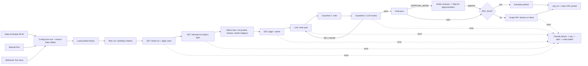

# PlacidWay → Facebook: daily auto-post workflow (n8n)

**Repository:** https://github.com/hrnbld/placidway-n8n-facebook-demo

A demo n8n workflow that, once a day, picks one new piece of public PlacidWay content (blog article, treatment package or patient Q&A answer), has an LLM turn it into a short Facebook post, runs it through two independent guardrails, and then publishes it to a test Facebook Page, schedules it, or sends it to a reviewer first. Every run is logged, and every failure sends an alert instead of failing silently.

- **n8n version:** 2.43.8 (current stable, Node.js 24). All nodes are core nodes, with no community nodes.
- **Test page:** NeuPix (`957899504078846`), owned by the candidate. The workflow will not publish to any page that is not in `FB_ALLOWED_PAGE_IDS`.
- **Safe by default:** `DRY_RUN=true` builds the exact Graph API request and sends nothing.

---

## 1. What's in this folder

| Path | What it is |
|---|---|
| `workflows/placidway-fb-daily-post.json` | **Main workflow** (60 nodes). Import this one. |
| `workflows/placidway-fb-error-handler.json` | Error workflow (safety net for anything the main flow doesn't catch). |
| `workflows/placidway-fb-dashboard.json` | Stretch goal: an HTML dashboard of every run at `GET /webhook/placidway-dashboard`. |
| `workflows/exported/` | The same three workflows, exported back out of a running n8n with `n8n export:workflow` (round-trip check). |
| `src/code/*.js` | Source of every Code node, as plain JS. `scripts/build_workflows.py` inlines it into the workflow JSON. |
| `.env.example` | Every setting, with comments. |
| `samples/SAMPLE_POSTS.md` | The 3 sample posts from real PlacidWay pages, generated by `scripts/generate_samples.sh`. |
| `tests/run_unit_tests.mjs` | 23 offline checks of the parsing, selection, guardrail and error-classification logic. |
| `tools/sandbox_services.py` | Local stand-ins (replay mirror, mock LLM, webhook sink, mock Graph API) for testing without touching anything public. |
| `output/` | Evidence from the verification runs (`TEST_REPORT.md`, `dashboard.html`, per-run JSON). |

## 2. Architecture



Three requests reach placidway.com per run (robots.txt, one sitemap, one page), each at least 1.1 s apart.

## 3. How each requirement is met

| # | Requirement | Implementation |
|---|---|---|
| 1 | Daily + manual trigger | `Daily Schedule` (cron `0 9 * * *`, `GENERIC_TIMEZONE`), `Manual Run`, plus `Run Now (Webhook)` for headless runs and demos (`?type=article|package|answer&approval=true`). |
| 2 | Extract | **Sitemaps**: `/1/sitemap_articles.xml` (5,129 URLs), `/1/sitemap_packages.xml` (3,817), `/sitemap/1/sitemap_answers.xml` (4,547; patient Q&A). One request lists every item with `lastmod` and (for articles) the featured image. Then one page request per run, parsed for title (H1 / `og:title`), summary (`og:description`, or the first paragraph), image (`og:image`, else the sitemap image) and main body text. See §7 for why. |
| 3 | Select, never twice | `pw_posted` Data Table holds every URL ever posted (or rejected). Selection = newest unposted item, skipping the treatment categories used in the last 3 posts. |
| 4 | Generate | Writer prompt returns JSON `{hook, lines[2-4], cta, hashtags[3-5], evidence[]}`. The workflow assembles the post (hook / lines / CTA / link / hashtags) and counts characters before the link (limit 500). |
| 5 | Guardrails | **Rules** (deterministic) **and** an **LLM reviewer** (temperature 0, separate prompt). Both must pass. On failure the issues go back to the writer for one rewrite, and a second failure blocks the post and sends an alert. See §8. |
| 6 | Publish with image | `POST /{page-id}/photos` (image URL + caption) when there's an image, `POST /{page-id}/feed` (message + link) otherwise. Scheduling (`FB_SCHEDULE_DELAY_MINUTES`) uses `/feed` with `published=false`, `scheduled_publish_time` and `unpublished_content_type=SCHEDULED`. |
| 7 | Review option | `APPROVAL_MODE=true`: the draft and one-click approve/reject links go to `REVIEW_WEBHOOK_URL` (Slack-compatible). A `Wait` node holds the execution until a link is clicked, or for 24 h, after which the run is logged as `expired`. |
| 8 | Logging + errors | `pw_runs` Data Table: one row per run with the item chosen, post text, FB post ID, status, guardrail attempts and error. Source and LLM HTTP calls retry 3× (5 s apart); Facebook publish calls deliberately do **not** auto-retry (a timeout may already have published, so it is flagged `FB_PUBLISH_UNCERTAIN` instead of risking a double post). Every risky node has an error output into `Classify Failure` → log → Slack alert → mark failed. An Error Trigger workflow catches anything else and skips errors that were already alerted, so each failure produces exactly one alert. In the demo, alerts and approval requests go to the Slack channel `#placidway-alerts` through an Incoming Webhook. |
| Stretch | Variety rotation | Mon–Sun content-type rotation (`CONTENT_ROTATION`) + treatment-category variety (`VARIETY_LOOKBACK`). |
| Stretch | Dashboard | `PlacidWay -> Facebook: Dashboard` workflow renders `pw_runs` as an HTML page with counts, posts, images, errors and approve/reject links for pending drafts. |
| Stretch | Image handling | Raw CDN image by default; `IMAGE_VARIANT=og` uses PlacidWay's own 1200×630 social crop; `none` forces a link post. |

## 4. Setup

### 4.1 Run n8n (Docker, recommended)

```bash
cp .env.example .env              # then edit: LLM_*, FB_*, ALERT_WEBHOOK_URL, WEBHOOK_URL
docker volume create n8n_data
docker run -d --name n8n -p 5678:5678 --env-file .env \
  -v n8n_data:/home/node/.n8n -v "$PWD/workflows:/workflows:ro" \
  docker.n8n.io/n8nio/n8n:2.43.8
docker exec n8n n8n import:workflow --input=/workflows/placidway-fb-error-handler.json
docker exec n8n n8n import:workflow --input=/workflows/placidway-fb-dashboard.json
docker exec n8n n8n import:workflow --input=/workflows/placidway-fb-daily-post.json
docker exec n8n n8n publish:workflow --id=PwFbDailyPost001     # activates schedule + webhook
docker exec n8n n8n publish:workflow --id=PwFbDashboard001
docker restart n8n
```

Open http://localhost:5678, create the owner account, and the three workflows are there. Import the error handler first, because the main workflow points to it by ID (`settings.errorWorkflow = PwFbErrorHandl01`).

### 4.2 Run n8n (npm)

```bash
npm install -g n8n@2.43.8          # Node.js >= 24
set -a; source .env; set +a
scripts/n8n_local.sh import && scripts/n8n_local.sh start      # ENV_FILE=.env scripts/n8n_local.sh ...
```

### 4.3 Required n8n settings

- `N8N_BLOCK_ENV_ACCESS_IN_NODE=false`: the workflow reads its configuration from environment variables, so it is portable and needs no credential objects. (Hardening option: move `LLM_API_KEY` and `FB_PAGE_TOKEN` into n8n credentials. §10 covers this.)
- `WEBHOOK_URL`: must be a URL the reviewer can open, because approve/reject links are built from it.
- No credentials need to be created. The Data Tables `pw_runs` and `pw_posted` are created automatically on the first run ("Reuse existing tables" is on).

## 5. Getting a Facebook Page token (one-time, about 10 minutes)

The workflow needs a **Page** access token for NeuPix with `pages_manage_posts`. A user token or an ads token will not work.

1. **Create a Meta app.** Go to https://developers.facebook.com/apps → *Create app* → use case *"Manage everything on your Page"* (or type *Business*). Development mode is fine, because you are an admin of both the app and the Page.
2. **Get a short-lived user token** in Graph API Explorer (https://developers.facebook.com/tools/explorer): select your app → *User Token* → add the permissions `pages_show_list`, `pages_read_engagement`, `pages_manage_posts` → *Generate Access Token* → when Facebook asks, tick the **NeuPix** page.
3. **Exchange it for a long-lived user token** (about 60 days):
   ```
   GET https://graph.facebook.com/v24.0/oauth/access_token?grant_type=fb_exchange_token
       &client_id={APP_ID}&client_secret={APP_SECRET}&fb_exchange_token={SHORT_LIVED_USER_TOKEN}
   ```
4. **Get the Page token** (a Page token obtained from a long-lived user token does not expire):
   ```
   GET https://graph.facebook.com/v24.0/me/accounts?access_token={LONG_LIVED_USER_TOKEN}
   ```
   Copy the `access_token` of the entry with `"id": "957899504078846"`.
5. **Verify it:** `GET https://graph.facebook.com/v24.0/debug_token?input_token={PAGE_TOKEN}&access_token={APP_ID}|{APP_SECRET}` should show `type: PAGE`, `expires_at: 0`, and scopes including `pages_manage_posts`.
6. Put it in `.env` as `FB_PAGE_TOKEN=...`, set `DRY_RUN=false`, and restart n8n.

Notes:
- If posts made while the app is in Development mode don't appear publicly, switch the app to Live mode (this needs a privacy-policy URL) or check while logged in as the Page admin.
- For production, use a Business Manager **system user** token instead of a personal one.
- When the token expires or is revoked, the run fails with `FB_TOKEN_EXPIRED` and the alert tells you to repeat steps 2–6.

## 6. How to run

| Action | How |
|---|---|
| Manual test in the editor | Open the main workflow → *Execute workflow* (uses `Manual Run`). |
| Headless / scripted | `curl -X POST http://localhost:5678/webhook/placidway-run` (optional `?type=answer&approval=true`, header `x-run-token` if `RUN_TOKEN` is set). `python3 tools/trigger_run.py type=article` does the same and prints a summary. |
| Daily | Activate (publish) the workflow. It runs at 09:00 `GENERIC_TIMEZONE`. |
| Approval mode | `APPROVAL_MODE=true` (or `?approval=true` on the webhook). The reviewer gets the draft plus approve/reject links in the webhook channel, and pending drafts also show links on the dashboard. |
| Dashboard | http://localhost:5678/webhook/placidway-dashboard |
| Logs | n8n UI → *Data tables* → `pw_runs`, `pw_posted`; or *Executions* for node-level detail. |
| Samples | `scripts/generate_samples.sh` (real LLM key, dry run) → `samples/SAMPLE_POSTS.md`. |
| Unit tests | `node tests/run_unit_tests.mjs` |

### Testing without touching anything public

`python3 tools/sandbox_services.py` starts four local doubles:

- `:8787` replay mirror of 6 real PlacidWay pages, the real robots.txt and real sitemap entries. `/__mode?set=down|cf` simulates an outage or a Cloudflare block.
- `:8788` deterministic mock LLM, for pipeline tests only. `/__inject?on=1` makes the next draft contain a forbidden claim and an invented price; `/__inject?on=1&sticky=1` injects into the rewrite too (forces a guardrail block).
- `:8789` webhook sink, which records alerts and review requests to `output/outbox.jsonl`.
- `:8790` mock Graph API. `/__token?expired=1` returns OAuth error 190.

`scripts/sandbox.env` (dry run) and `scripts/sandbox-live.env` (live branch against the mock Graph API) point the workflow at them.

## 7. Extraction method: why sitemaps (not RSS, HTML listing pages, or a headless browser)

- **Sitemaps are the site's own published index.** robots.txt points to them, every content type has one, and each entry carries `lastmod` (for "recent") and often `image:loc` (the featured image) with no extra request.
- **Minimal load.** 3 requests per day in total. Crawling listing pages would take dozens of requests and break whenever the listing UI changes.
- **No RSS feed is advertised.** robots.txt and the sitemap index list sitemaps only, and HTML listing pages would need pagination and break when the UI changes.
- **No headless browser needed.** Pages are server-rendered (the full text is in the HTML), so plain HTTP plus parsing is faster and cheaper, and the content is not hidden from crawlers.
- **Parser design.** It uses standard signals (`og:*` meta, `<h1>`, canonical) and cuts the body at the first non-content block ("Medical Disclaimer", "References", "Request your Free Quote", related listings, footer). Related-package cards carry *other* prices, so cutting them out is part of the no-invented-prices guarantee.
- **robots.txt** is fetched every run and applied with longest-match and Allow-wins-ties (RFC 9309), supporting `*` and `$`. `Crawl-delay` is honoured if present, and the workflow refuses to fetch disallowed paths.

## 8. Guardrails

**Guardrail 1: rules (deterministic, explainable, impossible to talk around)**
- Format: ≤ 500 characters before the link, 2–4 value lines, a CTA, 3–5 hashtags, exactly one URL (the source), ≤ 2 emojis.
- Medical claims and outcome promises: a regex list (cure, heal, reverse, eliminate, guaranteed, proven, safest, risk-free, painless, success rate, 100 %, permanent results, "will fix/restore/…", best doctor/clinic…).
- Prices: with `ALLOW_PRICES=false` (the default) any currency amount, or wording like "cheap", "affordable" or "save", fails. With `true`, each amount must appear verbatim in the source.
- Every number in the post must exist in the source page (catches invented stats, ages and durations).
- Grounding: each value line needs an `evidence` quote, and that quote must actually be found in the source text (after normalising case and punctuation).

**Guardrail 2: LLM reviewer.** A separate call with its own system prompt and temperature 0 (optionally a different model via `LLM_REVIEW_MODEL`) receives the source and the post and returns `{pass, issues[]}` typed as `medical_claim`, `outcome_promise`, `invented_price`, `unsupported_fact` or `misleading`. It catches what regex can't, such as implied promises or a fact twisted into a claim.

**Deliberate trade-off: strict quote grounding.** The rules check needs each value line's `evidence` quote to appear in the source text after only light normalisation (case and punctuation). It does not do fuzzy or semantic matching. That makes it stricter than strictly necessary: a quote that the LLM paraphrased slightly, or that spans list formatting on the page, fails even when the claim itself is true. In the test runs the first draft often failed this check, which costs one extra LLM call for the rewrite, and occasionally a post is blocked and alerted rather than published. I kept it this way on purpose. For medical content, a false "blocked" (one extra call, or a skipped day) is much cheaper than a false "published" (an unsupported claim on a public page). Loosening it (fuzzy matching, or letting the LLM reviewer overrule the rules) is a one-function change if the team prefers a different balance.

**Decision:** publish only if both pass. Otherwise the combined issues go back to the writer for one rewrite (`MAX_REWRITES=1`). If the rewrite also fails, the run is logged as `guardrail_blocked`, the blocked draft is kept in the log, and an alert is sent.

## 9. Storage: n8n Data Tables (why)

- Built into n8n 2.x, so there is no extra service or credential, and the tables are visible and editable in the UI (useful in a demo and for operators).
- Created automatically by the workflow (`Ensure Table` nodes) and referenced **by name**, so the export is portable.
- Two tables:
  - `pw_posted` (`url, title, content_type, category, fb_post_id, status, posted_at`) is the de-duplication store.
  - `pw_runs` (`run_id, started_at, finished_at, trigger, mode, content_type, category, item_url, item_title, image_url, post_text, chars_before_link, attempts, guardrail, fb_post_id, status, error, review_url`) is the run log. It is upserted by `run_id`, so a pending-approval row becomes the final row.
- Upgrade path: Postgres or Google Sheets if several workflows or people need the data. The nodes are isolated, so swapping means changing about 5 nodes.

## 10. Security notes and known limitations

- **Cloudflare challenge from datacenter IPs.** placidway.com answers some cloud IPs with a Cloudflare "Just a moment" challenge (HTTP 403 + `cf-mitigated: challenge`). This is what happened in the development sandbox (an AWS IP): robots.txt was readable, but the sitemaps and pages were not. The workflow detects this, classifies it as `SOURCE_BLOCKED`, alerts, and does **not** try to bypass it. Run n8n from a network that isn't challenged (a home/office line or many VPS providers), or, in a real engagement, ask PlacidWay to allow-list the bot's user agent or IP. The replay mirror in `tools/` exists only so the pipeline could be tested end to end in that sandbox.
- **Secrets.** `LLM_API_KEY` and `FB_PAGE_TOKEN` are read from env at the moment of the call and are never written into item data, so they never appear in execution logs. A production hardening step would store them as n8n credentials (Header Auth) and keep `N8N_BLOCK_ENV_ACCESS_IN_NODE=true`.
- **Retries.** Source and LLM HTTP nodes retry 3× with a 5 s gap on any error, including 403s and 4xx errors that won't recover. That is acceptable at 3 requests a day, and finer per-status retry is a listed improvement. Facebook publish nodes never auto-retry: a timeout after the POST left may mean the post is already live, so the run is logged as `publish_uncertain` and the alert says to check the Page before re-running.
- **Page allow-list.** Publishing is refused unless `FB_PAGE_ID` is in `FB_ALLOWED_PAGE_IDS`, so a misconfigured env cannot post to someone else's page (and never to a PlacidWay page).
- **Concurrency.** It is designed for 1 run a day. For bursts of manual runs, set `N8N_CONCURRENCY_PRODUCTION_LIMIT=1` so the 1 req/s spacing holds across runs.

## 11. Rebuilding the workflow JSON

```bash
python3 scripts/build_workflows.py   # src/code/*.js -> workflows/*.json
node tests/run_unit_tests.mjs        # 23 checks
```

Edit logic in `src/code/`, not inside the JSON. `//@include lib/llm.js` inlines shared helpers (LLM adapter, prompts), because n8n Code nodes can't import local files.
